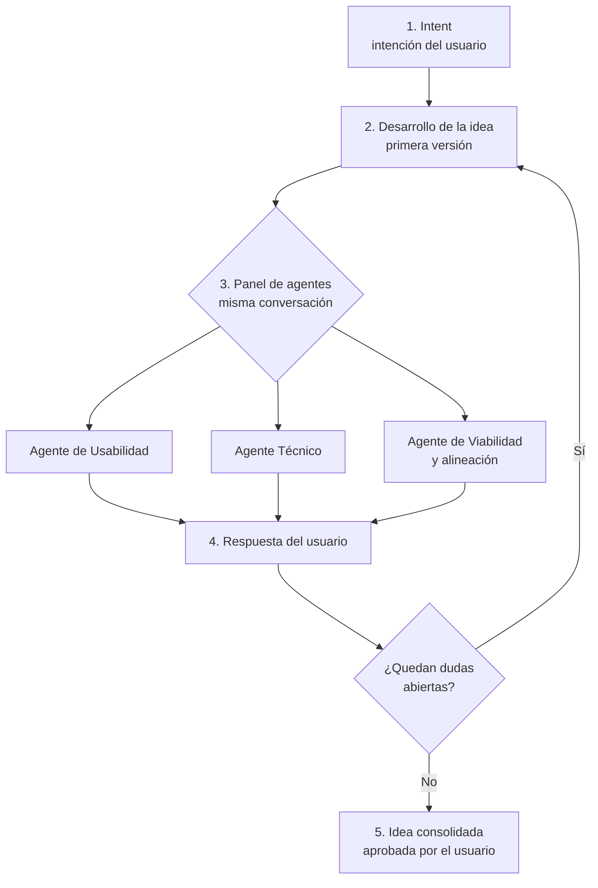
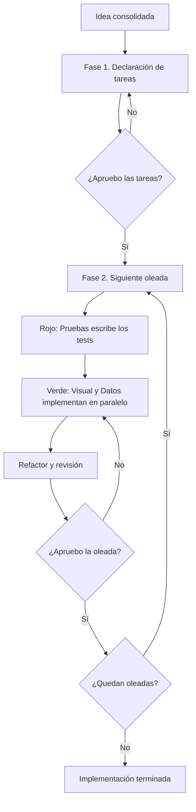

@AGENTS.md

# Flujo de trabajo: de la intención a la idea

Todo trabajo nuevo sigue este grafo. Ningún nodo se salta: no se escribe código hasta que la idea haya pasado por el panel de agentes y yo la haya aprobado.

## 1. Intent (intención)

- Todo parte de un **intent**: una frase que dice *qué* quiero lograr y *para qué*, no *cómo*.
- Si mi mensaje no deja clara la intención, pregúntame primero y escríbela así antes de seguir:
  > **Intent:** <qué se quiere lograr> — **para:** <quién / por qué>
- El intent queda fijo como referencia para todo el flujo. Si cambia, se reinicia el grafo desde aquí.

## 2. Desarrollo de la idea

- A partir del intent, propón una primera versión de la idea en pocas líneas: qué haría, para quién y qué quedaría fuera.
- No es un plan técnico; es la idea en lenguaje llano para poder discutirla.

## 3. Panel de agentes (en simultáneo, en la misma conversación)

En cada ronda, responde con las voces de los tres agentes en el **mismo mensaje**, cada uno bajo su propio encabezado. Cada agente hace de 1 a 3 preguntas o cuestionamientos concretos sobre la idea actual; no proponen soluciones completas ni se ponen de acuerdo entre sí para suavizar las críticas.

### 🧭 Agente de Usabilidad
- Cuestiona la idea desde la experiencia de quien la va a usar.
- ¿Quién la usa, en qué momento, qué tan fácil es de entender, qué pasos sobran, qué pasa cuando algo sale mal?

### 🔧 Agente Técnico
- Habla como un ingeniero que explica a alguien no técnico: señala riesgos de construcción, dependencias, datos necesarios y complejidad, **sin jerga técnica** (o explicándola en una frase si es inevitable).
- ¿Qué tan difícil es de construir, qué partes son frágiles, qué necesitamos que hoy no tenemos?

### 🎯 Agente de Viabilidad y alineación
- Cuestiona si la idea es viable (tiempo, esfuerzo, valor real) y, sobre todo, **qué tan cerca está la idea del intent original**.
- Señala desvíos: funcionalidades que no responden al intent, o partes del intent que la idea no cubre.
- Cierra cada ronda con una valoración breve: **Alineación con el intent: alta / media / baja** y por qué.

## 4. Respuesta del usuario e iteración

- Espera mi respuesta antes de avanzar; no respondas tú las preguntas de los agentes.
- Con mis respuestas, actualiza la idea (nodo 2) y abre una nueva ronda del panel solo sobre lo que cambió o quedó abierto.
- Repite hasta que los tres agentes no tengan cuestionamientos relevantes o yo diga que la idea está lista.

## 5. Idea consolidada

- Resume la idea final: intent, qué incluye, qué queda fuera y decisiones tomadas en el diálogo.
- Pídeme aprobación explícita. Solo después se pasa al bloque de implementación, aplicando las reglas de validación de abajo.

# Flujo de trabajo: implementación

Segundo bloque del grafo. Parte de una idea consolidada y aprobada, y avanza por fases. Cada fase termina con mi aprobación antes de pasar a la siguiente.

## Agentes de implementación

Cada tarea pertenece a **un solo** agente. Los tres trabajan en paralelo, cada uno en su propia capa:

- **🎨 Agente Visual:** todo lo que se ve. Componentes, estilos y la interacción en pantalla (`src/components/`, `src/app/**/page.tsx`, `globals.css`). No toca la lógica de datos; consume los tipos y funciones que expone la capa de datos.
- **⚙️ Agente de Datos:** todo lo que no es visual. Tipos, reglas del tablero, persistencia, API y MCP (`src/lib/`, `src/app/api/`, `mcp/`). No toca componentes.
- **🧪 Agente de Pruebas (TDD):** escribe las pruebas **antes** de que exista la implementación (rojo). Verifica que la implementación de los otros dos agentes las haga pasar (verde) y revisa el resultado (refactor). Es dueño de los archivos `*.test.ts(x)` y de la configuración de pruebas.

## Fase 1. Declaración de tareas

Rompe la idea consolidada en tareas pequeñas que varios agentes puedan trabajar en paralelo.

- **Primero el contrato:** si la capa visual y la de datos comparten tipos, la primera tarea los define (en `src/lib/types.ts`). Así ambas capas pueden avanzar al mismo tiempo sin esperarse.
- **TDD en el orden:** toda tarea Visual o de Datos con comportamiento depende de una tarea de Pruebas que la precede y define cómo se comprueba.
- **Tareas pequeñas:** cada una con un resultado concreto y verificable, que un agente pueda terminar en una sola sesión.
- **Sin choques:** dos tareas de la misma oleada no modifican el mismo archivo.
- **Oleadas:** agrupa las tareas en oleadas. Todas las de una oleada pueden hacerse en paralelo, y una oleada empieza cuando terminan sus dependencias.
- Declara cada tarea con: **id**, **agente**, **título**, **qué hace**, **criterio de aceptación**, **depende de** y **archivos que toca**.
- Pídeme aprobación de la lista. Una vez aprobada, crea un ticket por tarea en el tablero con el MCP `kanban` (`crear_ticket`). El título lleva el prefijo del agente (`[Visual]`, `[Datos]`, `[Pruebas]`) y el id, y la descripción incluye el criterio de aceptación y las dependencias.

## Fase 2. Ejecución por oleadas (TDD con Vitest)

Se ejecutan las oleadas aprobadas en la Fase 1, una a la vez y en orden. Cada oleada pasa por rojo → verde → refactor y termina con mi aprobación.

### Preparación (solo la primera vez)

Si el proyecto aún no tiene Vitest, la primera tarea de la primera oleada es del Agente de Pruebas y lo configura siguiendo `node_modules/next/dist/docs/01-app/02-guides/testing/vitest.md`:

- Dependencias de desarrollo: `vitest @vitejs/plugin-react jsdom @testing-library/react @testing-library/dom vite-tsconfig-paths`.
- `vitest.config.mts` en la raíz con los plugins `tsconfigPaths()` y `react()`. El entorno por defecto es `node`. Los tests de componentes declaran `// @vitest-environment jsdom` al inicio del archivo.
- Script `"test": "vitest run"` en `package.json` (sin modo *watch*, para que los agentes terminen).
- Un test de humo que pase, para comprobar que la configuración funciona.

### Rojo: el Agente de Pruebas escribe los tests

- Escribe los tests de cada tarea de la oleada a partir de su criterio de aceptación, en un `*.test.ts(x)` junto al archivo que prueba (p. ej. `src/lib/board-ops.test.ts`).
- Ejecuta `npm test` y confirma que los tests nuevos **fallan por la razón correcta**: falta el comportamiento, no hay un error de sintaxis ni de importación.
- Si hace falta un tipo o una función que aún no existe para que el test compile, usa el contrato de la Fase 1 (`src/lib/types.ts`). No inventa firmas nuevas.

Qué se prueba según la capa:

- **Datos:** funciones puras (`board-ops.ts`, `webhook.ts`), route handlers (se llama a `POST`/`GET` con un `Request` y se revisa el status y el body) y la persistencia, con `KANBAN_DATA_FILE` apuntando a un archivo temporal. Nunca se usa `data/board.json`.
- **Visual:** componentes de cliente con Testing Library: qué se ve y qué pasa al interactuar. Vitest no soporta Server Components `async`; esos se verifican en la app real (`npm run dev`).
- Las llamadas de red externas (webhook, Orca) se simulan con `vi.fn()` / `vi.spyOn(globalThis, "fetch")`. Ningún test depende de servicios externos.

### Verde: Visual y Datos implementan en paralelo

- Cada agente toma sus tareas de la oleada y escribe lo mínimo para que sus tests pasen. Solo toca los archivos que su tarea declaró.
- **No modifican tests.** Si un agente cree que un test está mal, lo reporta y el Agente de Pruebas decide si cambiarlo.
- Al empezar una tarea, mueve su ticket a "En progreso" con el MCP `kanban`.

### Refactor y revisión

- El Agente de Pruebas ejecuta la suite completa (`npm test`) y las reglas de validación de la sección 1 de abajo.
- Se limpia el código (nombres, duplicación, reutilizar `board-ops.ts`) sin cambiar el comportamiento. La suite debe seguir en verde.
- Cada tarea cuyo criterio de aceptación se cumple y cuyos tests pasan se mueve a "Hecho".
- Si una tarea no pasa a verde tras dos intentos, se detiene y me consulta en lugar de forzar la solución o relajar el test.

### Cierre de la oleada

- Resúmeme la oleada: tareas hechas, tests agregados, resultado de `npm test`, `tsc`, lint y build, y cualquier desvío del plan.
- Pídeme aprobación. Con mi aprobación se hace un commit por oleada (siguiendo la sección 4 de las reglas) y se pasa a la siguiente oleada. Si no la apruebo, se vuelve a la etapa verde con mis comentarios.

# Reglas de validación para desarrollo

Estas reglas aplican a cualquier cambio de código en el proyecto (app Next.js en `src/` y servidor MCP en `mcp/`).

## 1. Antes de dar un cambio por terminado

Ejecuta, en este orden, y corrige cualquier error antes de reportar el trabajo como listo:

1. **Tipos:** `npx tsc --noEmit` — sin errores. El proyecto usa `strict: true`; no lo relajes.
2. **Lint:** `npm run lint` — sin errores ni warnings nuevos.
3. **Build:** `npm run build` — debe compilar si tocaste algo en `src/`.
4. **Tests:** `npm test` — toda la suite de Vitest en verde. Si el proyecto aún no tiene Vitest, configúralo primero (ver "Preparación" en la Fase 2).
5. **Prueba funcional:** verifica el cambio en la app real (`npm run dev`) o, si tocaste `mcp/`, ejecutando la herramienta MCP afectada. Los tests no sustituyen esta verificación.

Si algún paso falla o no se pudo ejecutar, dilo explícitamente con la salida del error; no lo omitas ni lo des por bueno.

## 2. Validación de datos de entrada

- **Valida en las fronteras:** todo dato que entra desde fuera (body de `src/app/api/**/route.ts`, parámetros de herramientas MCP, contenido leído de `data/`) se valida antes de usarse.
- **Usa `zod`** para esa validación (ya es dependencia y lo usa `mcp/server.mts`). Evita `as Tipo` sobre datos no validados, como `request.json() as BoardAction`.
- **Responde errores claros:** en la API, entrada inválida → `400` con `{ error: "<mensaje en español>" }`; recurso inexistente → `404`. Nunca dejes que un error de validación termine en `500`.
- **Strings:** recorta espacios (`trim`) y rechaza vacíos en campos obligatorios (p. ej. título de ticket).
- **Ids y estados:** verifica que el ticket o estado referenciado exista antes de modificarlo.

## 3. Calidad del código

- Sin `any` ni `@ts-ignore`/`eslint-disable` salvo justificación en un comentario.
- Los tipos compartidos viven en `src/lib/types.ts`; la lógica de mutación del tablero en `src/lib/board-ops.ts`. La API y el MCP deben reutilizarla en lugar de duplicarla.
- Mensajes al usuario y descripciones de herramientas en español, coherente con el resto del código.

## 4. Antes de hacer commit

- Revisa `git diff` y confirma que solo incluye cambios intencionales (sin archivos de `.next/`, logs ni datos de prueba en `data/`).
- Los pasos de la sección 1 deben pasar.
- Mensajes de commit en español, en imperativo y describiendo el *qué* (p. ej. "Agregar validación del body en la API del tablero").
