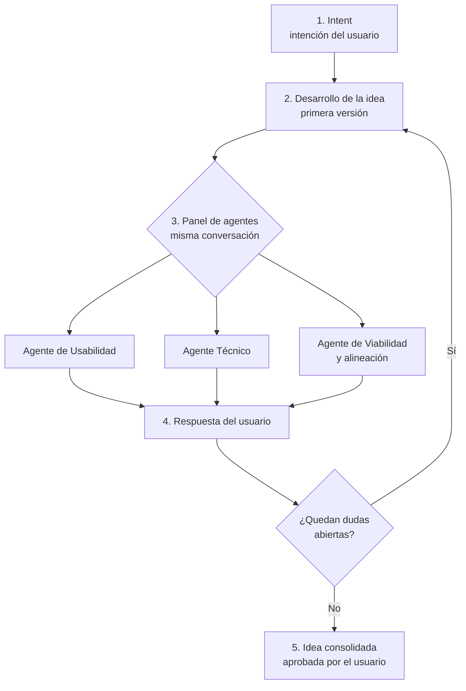

@AGENTS.md

# Flujo de trabajo: de la intención a la idea

Todo trabajo nuevo sigue este grafo. Ningún nodo se salta: no se escribe código hasta que la idea haya pasado por el panel de agentes y yo la haya aprobado.

## 1. Intent (intención)

- Todo parte de un **intent**: una frase que dice *qué* quiero lograr y *para qué*, no *cómo*.
- Si mi mensaje no deja clara la intención, pregúntame primero y escríbela así antes de seguir:
  > **Intent:** <qué se quiere lograr> — **para:** <quién / por qué>
- El intent queda fijo como referencia para todo el flujo. Si cambia, se reinicia el grafo desde aquí.

## 2. Desarrollo de la idea

- A partir del intent, propón una primera versión de la idea en pocas líneas: qué haría, para quién y qué quedaría fuera.
- No es un plan técnico; es la idea en lenguaje llano para poder discutirla.

## 3. Panel de agentes (en simultáneo, en la misma conversación)

En cada ronda, responde con las voces de los tres agentes en el **mismo mensaje**, cada uno bajo su propio encabezado. Cada agente hace de 1 a 3 preguntas o cuestionamientos concretos sobre la idea actual; no proponen soluciones completas ni se ponen de acuerdo entre sí para suavizar las críticas.

### 🧭 Agente de Usabilidad
- Cuestiona la idea desde la experiencia de quien la va a usar.
- ¿Quién la usa, en qué momento, qué tan fácil es de entender, qué pasos sobran, qué pasa cuando algo sale mal?

### 🔧 Agente Técnico
- Habla como un ingeniero que explica a alguien no técnico: señala riesgos de construcción, dependencias, datos necesarios y complejidad, **sin jerga técnica** (o explicándola en una frase si es inevitable).
- ¿Qué tan difícil es de construir, qué partes son frágiles, qué necesitamos que hoy no tenemos?

### 🎯 Agente de Viabilidad y alineación
- Cuestiona si la idea es viable (tiempo, esfuerzo, valor real) y, sobre todo, **qué tan cerca está la idea del intent original**.
- Señala desvíos: funcionalidades que no responden al intent, o partes del intent que la idea no cubre.
- Cierra cada ronda con una valoración breve: **Alineación con el intent: alta / media / baja** y por qué.

## 4. Respuesta del usuario e iteración

- Espera mi respuesta antes de avanzar; no respondas tú las preguntas de los agentes.
- Con mis respuestas, actualiza la idea (nodo 2) y abre una nueva ronda del panel solo sobre lo que cambió o quedó abierto.
- Repite hasta que los tres agentes no tengan cuestionamientos relevantes o yo diga que la idea está lista.

## 5. Idea consolidada

- Resume la idea final: intent, qué incluye, qué queda fuera y decisiones tomadas en el diálogo.
- Pídeme aprobación explícita. Solo después se pasa a planificar o implementar, aplicando las reglas de validación de abajo.

# Reglas de validación para desarrollo

Estas reglas aplican a cualquier cambio de código en el proyecto (app Next.js en `src/` y servidor MCP en `mcp/`).

## 1. Antes de dar un cambio por terminado

Ejecuta, en este orden, y corrige cualquier error antes de reportar el trabajo como listo:

1. **Tipos:** `npx tsc --noEmit` — sin errores. El proyecto usa `strict: true`; no lo relajes.
2. **Lint:** `npm run lint` — sin errores ni warnings nuevos.
3. **Build:** `npm run build` — debe compilar si tocaste algo en `src/`.
4. **Prueba funcional:** el proyecto aún no tiene tests automatizados, así que verifica el cambio en la app real (`npm run dev`) o, si tocaste `mcp/`, ejecutando la herramienta MCP afectada.

Si algún paso falla o no se pudo ejecutar, dilo explícitamente con la salida del error; no lo omitas ni lo des por bueno.

## 2. Validación de datos de entrada

- **Valida en las fronteras:** todo dato que entra desde fuera (body de `src/app/api/**/route.ts`, parámetros de herramientas MCP, contenido leído de `data/`) se valida antes de usarse.
- **Usa `zod`** para esa validación (ya es dependencia y lo usa `mcp/server.mts`). Evita `as Tipo` sobre datos no validados, como `request.json() as BoardAction`.
- **Responde errores claros:** en la API, entrada inválida → `400` con `{ error: "<mensaje en español>" }`; recurso inexistente → `404`. Nunca dejes que un error de validación termine en `500`.
- **Strings:** recorta espacios (`trim`) y rechaza vacíos en campos obligatorios (p. ej. título de ticket).
- **Ids y estados:** verifica que el ticket o estado referenciado exista antes de modificarlo.

## 3. Calidad del código

- Sin `any` ni `@ts-ignore`/`eslint-disable` salvo justificación en un comentario.
- Los tipos compartidos viven en `src/lib/types.ts`; la lógica de mutación del tablero en `src/lib/board-ops.ts`. La API y el MCP deben reutilizarla en lugar de duplicarla.
- Mensajes al usuario y descripciones de herramientas en español, coherente con el resto del código.

## 4. Antes de hacer commit

- Revisa `git diff` y confirma que solo incluye cambios intencionales (sin archivos de `.next/`, logs ni datos de prueba en `data/`).
- Los pasos de la sección 1 deben pasar.
- Mensajes de commit en español, en imperativo y describiendo el *qué* (p. ej. "Agregar validación del body en la API del tablero").
